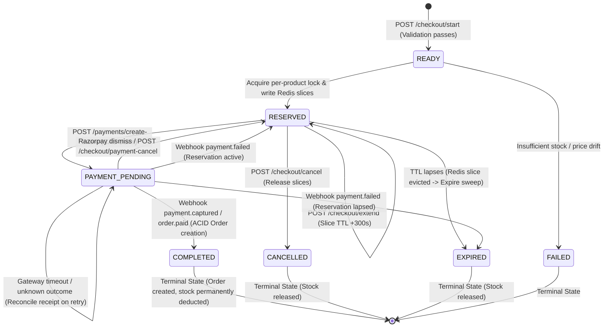

# WollyWay Checkout State Machine & Concurrency Architecture

## 1. Overview

This document specifies the authoritative state machine for WollyWay's checkout, inventory reservation, and payment lifecycle. It formalizes transitions, concurrency boundaries, Redis reservation slicing, distributed locking, and payment reconciliation invariants.

---

## 2. State Machine Diagram

---

## 3. Supported States

| State | Classification | Description |
|---|---|---|
| `CREATED` / `READY` | Transient | Checkout session initialized, cart validated, awaiting reservation lock. |
| `RESERVED` | Active | Inventory reserved in Redis slices (`checkout:rsv:{sessionId}:{productId}`) for 15 minutes. Session is payable. |
| `PAYMENT_PENDING` | Critical In-Flight | Session claimed for payment. Gateway intent created or in progress. Unsafe operations (cancellation, restart) are blocked. Protected from sweeper expiration. |
| `COMPLETED` | Terminal | Payment captured and verified; MongoDB order created; cart cleared; Redis reservation slices purged. |
| `CANCELLED` | Terminal | Customer explicitly cancelled checkout; Redis slices purged. |
| `EXPIRED` | Terminal | Reservation time window lapsed; Redis slices naturally evicted; session finalized. |
| `FAILED` | Terminal | Validation failed or stock could not be acquired during checkout initiation. |

---

## 4. State Transition Specifications

### 4.1. Transition: `NEW -> READY -> RESERVED`
- **Trigger**: `POST /api/v1/checkout/start`
- **Authorization**: Authenticated Customer (`req.user._id`).
- **Server-Side Invariants**:
  - Cart must not be empty.
  - Live product status must be `published`.
  - Live catalog price must match cart price snapshot.
  - Customer must not have an existing active session in `PAYMENT_PENDING` (returns `409 Conflict`). Any active `RESERVED` session is cancelled first.
  - Per-product advisory locks (`checkout:lock:{productId}`) must be acquired in canonical lexicographical order.
- **Redis Effect**:
  - Per-product locks held for critical section (PX 5000 NX, ownership token verified on release).
  - Slices written: `SET checkout:rsv:{sessionId}:{productId} {quantity} EX 900`.
  - Session metadata written: `SET checkout:reservation:{sessionId} {json} EX 900`.
- **MongoDB Effect**:
  - `CheckoutSession` created with status `RESERVED`, frozen `cartSnapshot`, verified `shippingAddressSnapshot` (if present), `reservationExpiresAt: Date.now() + 15m`.
- **Retry Allowed**: Yes (idempotency key or fresh start).
- **Payment Reconciliation Required**: No.

---

### 4.2. Transition: `RESERVED -> PAYMENT_PENDING` (Atomic Claim)
- **Trigger**: `POST /api/v1/payments/create-intent`
- **Authorization**: Authenticated Customer (`req.user._id`).
- **Server-Side Invariants**:
  - **LOOP-01 Guard**: Strict shipping address validation at payment boundary. `street`, `city`, `state`, `postalCode`, and `country` must all be non-empty strings.
  - Reservation must not be expired (`reservationExpiresAt > Date.now()`).
  - **LOOP-02 CAS**: Repository-level atomic `findOneAndUpdate({ _id: sessionId, status: 'RESERVED' }, { $set: { status: 'PAYMENT_PENDING', paymentProvider, paymentAttemptReceipt } })`.
  - Deterministic reconciliation receipt generated and pre-persisted: `rcpt_{sessionId}` (length 29 chars, under 40-char limit).
- **Concurrent Request Handling**:
  - Winning request claims `RESERVED -> PAYMENT_PENDING`.
  - Losing concurrent request receives `null` from CAS, pauses and polls the session for up to 3 seconds with exponential backoff to safely reuse the winning request's `paymentIntentId`.
  - Gateway order creation is never duplicated.
- **Redis Effect**: None (slice TTL remains intact).
- **MongoDB Effect**: Status updated to `PAYMENT_PENDING`; `paymentProvider` and `paymentAttemptReceipt` set.
- **Retry Allowed**: Yes.
- **Payment Reconciliation Required**: Yes, on retry if previous call yielded an unknown outcome.

---

### 4.3. Transition: Unknown Gateway Outcome (`PAYMENT_PENDING -> PAYMENT_PENDING`)
- **Trigger**: Gateway timeout, connection reset (`ECONNRESET`), socket abort, or gateway 5xx response during `razorpay.orders.create()`.
- **Server-Side Invariants**:
  - **CRITICAL INVARIANT**: **NEVER rollback to `RESERVED` on an unknown gateway outcome.**
  - `PAYMENT_PENDING` remains persisted in MongoDB.
  - `paymentAttemptReceipt` remains persisted in MongoDB.
  - Returns HTTP `503 Service Unavailable` with operational flag `{ isUnknownOutcome: true }`.
  - No second Razorpay order may be created blindly.
- **Redis Effect**: None.
- **MongoDB Effect**: Status remains `PAYMENT_PENDING`.
- **Retry Allowed**: Yes.
- **Payment Reconciliation Required**: **MANDATORY**. Next `createPaymentIntent` call must invoke `razorpay.orders.all({ receipt })` to check whether the order was actually created before attempting order creation.

---

### 4.4. Transition: Definite Gateway Rejection (`PAYMENT_PENDING -> RESERVED`)
- **Trigger**: Gateway returns an explicit 4xx HTTP response (e.g. 400 Bad Request, currency error, invalid payload).
- **Server-Side Invariants**:
  - Verifiable evidence that no gateway order was created.
  - Safe to revert status back to `RESERVED` and reset `paymentIntentId: null`.
  - Returns HTTP `400 Bad Request` with provider error description.
- **Redis Effect**: None (stock reservation slice remains preserved).
- **MongoDB Effect**: Status transitioned back to `RESERVED`; `paymentIntentId` and `paymentProvider` cleared.
- **Retry Allowed**: Yes, customer can correct input and retry.
- **Payment Reconciliation Required**: No.

---

### 4.5. Transition: Client Payment Dismiss / Cancel (`PAYMENT_PENDING -> RESERVED`)
- **Trigger**: Customer dismisses Razorpay modal (`modal.ondismiss`) or client fires `POST /api/v1/checkout/payment-cancel`.
- **Authorization**: Authenticated Customer (`req.user._id`).
- **Server-Side Invariants**:
  - Session must be actively in `PAYMENT_PENDING` (or already `RESERVED`).
  - Reservation window must not have expired (`reservationExpiresAt > Date.now()`).
  - Cannot be used to cancel the entire checkout; only recovers the payment intent so customer can choose another payment method or retry.
- **Redis Effect**: None.
- **MongoDB Effect**: Status transitioned to `RESERVED`; `paymentIntentId` and `paymentProvider` cleared.
- **Retry Allowed**: Yes.
- **Payment Reconciliation Required**: No.

---

### 4.6. Transition: Provider Payment Failure Webhook (`PAYMENT_PENDING -> RESERVED` or `EXPIRED`)
- **Trigger**: Verified webhook event `payment.failed` from payment gateway.
- **Authorization**: Cryptographic HMAC SHA256 signature verification (`x-razorpay-signature`).
- **Server-Side Invariants**:
  - Webhook event idempotency claimed in `PaymentWebhookEvent` repository.
  - If session already `COMPLETED`: Harmlessly absorbed.
  - If session is `PAYMENT_PENDING`:
    - If reservation is still active (`reservationExpiresAt > Date.now()`): Transition to `RESERVED` to permit customer retry.
    - If reservation window expired (`reservationExpiresAt <= Date.now()`): Transition to `EXPIRED` and purge Redis slices.
- **Redis Effect**: If expired, slice keys deleted. If active, slices retained.
- **MongoDB Effect**: Status updated to `RESERVED` (or `EXPIRED`); event status updated to `PROCESSED`.
- **Retry Allowed**: Yes.
- **Payment Reconciliation Required**: No.

---

### 4.7. Transition: Provider Payment Success Webhook (`PAYMENT_PENDING -> COMPLETED`)
- **Trigger**: Verified webhook event `payment.captured` or `order.paid`.
- **Authorization**: Cryptographic HMAC SHA256 signature verification (`x-razorpay-signature`).
- **Server-Side Invariants**:
  - Webhook event idempotency claimed in `PaymentWebhookEvent` repository.
  - Session resolved via `metadata.checkoutSessionId` or `gatewayOrderId`.
  - Amount and currency strictly reconciled against frozen snapshots.
  - Executed inside multi-document MongoDB ACID transaction:
    1. Order persisted in `CONFIRMED` state.
    2. Physical stock permanently decremented via `InventoryTransaction`.
    3. `CheckoutSession` status updated to `COMPLETED`.
    4. Customer's `Cart` cleared.
  - Post-transaction action: Redis reservation slices purged.
- **Redis Effect**: Slice keys `checkout:rsv:{sessionId}:{productId}` and session payload key deleted.
- **MongoDB Effect**: `CheckoutSession.status` set to `COMPLETED`.
- **Retry Allowed**: No (terminal state).
- **Payment Reconciliation Required**: Completed.

---

### 4.8. Transition: Reservation Extension (`RESERVED -> RESERVED`)
- **Trigger**: `POST /api/v1/checkout/extend`
- **Authorization**: Authenticated Customer (`req.user._id`).
- **Server-Side Invariants**:
  - `session.status` must be `RESERVED`.
  - `extensionCount` must be < 3.
  - `reservationExpiresAt` must be > Date.now().
  - **Redis Slice Verification**: Every slice `checkout:rsv:{sessionId}:{productId}` must exist in Redis (`ttl > 0`). If any slice expired, extension is rejected and session transitioned to `EXPIRED`.
  - **Ordering**: Redis slice TTLs extended (`EXPIRE key ttl + 300`) **BEFORE** MongoDB metadata is updated to prevent cache/DB drift.
- **Redis Effect**: All session slice keys extended by 300 seconds.
- **MongoDB Effect**: `reservationExpiresAt` extended by 5 minutes; `extensionCount` incremented.
- **Retry Allowed**: Yes, up to 3 times maximum.
- **Payment Reconciliation Required**: No.

---

### 4.9. Transition: User Cancellation (`RESERVED -> CANCELLED`)
- **Trigger**: `POST /api/v1/checkout/cancel`
- **Authorization**: Authenticated Customer (`req.user._id`).
- **Server-Side Invariants**:
  - Session must NOT be in `PAYMENT_PENDING` (throws `409 Conflict`).
  - Active reservation slices purged from Redis.
- **Redis Effect**: Session slice keys `checkout:rsv:{sessionId}:{productId}` deleted.
- **MongoDB Effect**: `CheckoutSession.status` set to `CANCELLED`.
- **Retry Allowed**: No (customer starts a new checkout).
- **Payment Reconciliation Required**: No.

---

### 4.10. Transition: Reservation Expiration (`RESERVED -> EXPIRED`)
- **Trigger**: Natural Redis slice TTL expiry + background sweeper / session lookup check.
- **Server-Side Invariants**:
  - `session.status` must NOT be `PAYMENT_PENDING` or `COMPLETED`.
  - Sessions in `PAYMENT_PENDING` are strictly excluded from expiration sweeps.
- **Redis Effect**: Naturally evicted by Redis when TTL expires, or explicitly deleted by sweeper.
- **MongoDB Effect**: `CheckoutSession.status` set to `EXPIRED`.
- **Retry Allowed**: No (customer starts a new checkout).
- **Payment Reconciliation Required**: No.

---

### 4.11. Terminal Checkout Cleanup
- **Trigger**: Server bootstrap and periodic cleanup sweeps (`reconcileStaleSessions()`).
- **Server-Side Invariants**:
  - Legacy `createdAt_1` 900-second TTL index dropped to prevent premature deletion of active sessions.
  - Deletes documents matching: `status IN ['COMPLETED', 'CANCELLED', 'EXPIRED', 'FAILED']` AND `updatedAt < Date.now() - 48 hours`.
  - `PAYMENT_PENDING` and active `RESERVED` sessions are **never deleted**.
- **Redis Effect**: None.
- **MongoDB Effect**: Safe deletion of terminal sessions older than 48 hours.

---

## 5. Summary of Critical Invariants

1. **Inventory Slices**: No shared aggregate counters. Slices are keyed by `checkout:rsv:{sessionId}:{productId}` with natural TTL. Available inventory is calculated as `dbStock - sum(active_slices)`.
2. **Advisory Locking**: Reservations acquire per-product locks (`checkout:lock:{productId}`) in lexicographical order, and release via ownership-verified Lua scripts. Naive `DEL` is strictly prohibited.
3. **No Gateway Rollback on Uncertainty**: Ambiguous gateway outcomes (timeouts, resets, 5xx) preserve `PAYMENT_PENDING` and the deterministic receipt. Retries reconcile with Razorpay via `orders.all({ receipt })` before creating an order.
4. **Protected PAYMENT_PENDING**: Sessions in `PAYMENT_PENDING` cannot be cancelled, expired by background sweepers, restarted, or deleted by MongoDB TTL.
5. **Idempotent Webhooks**: All webhooks are cryptographically validated and atomically claimed before processing. Duplicate success or failure events are safely absorbed without side effects.
