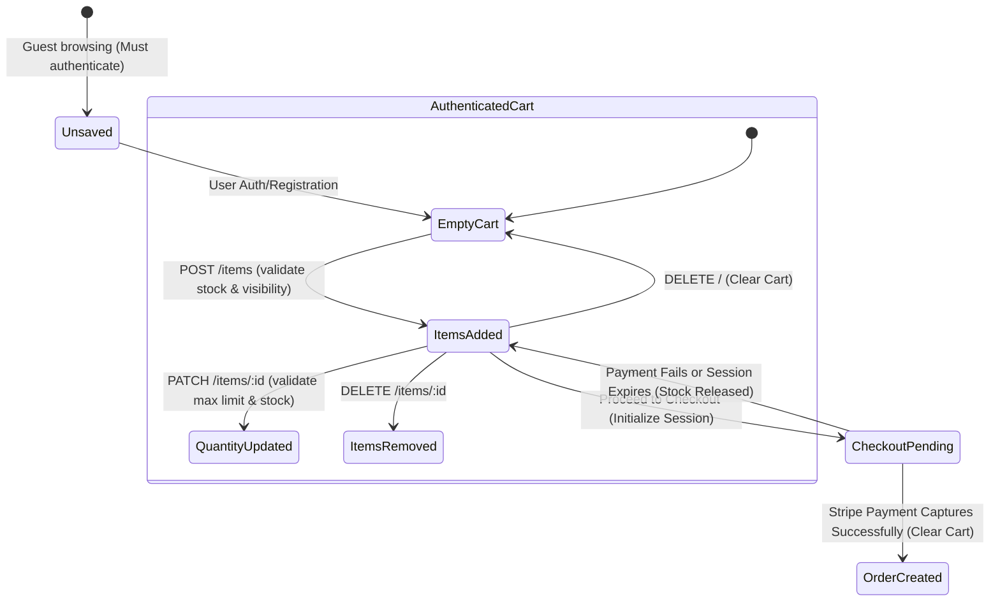
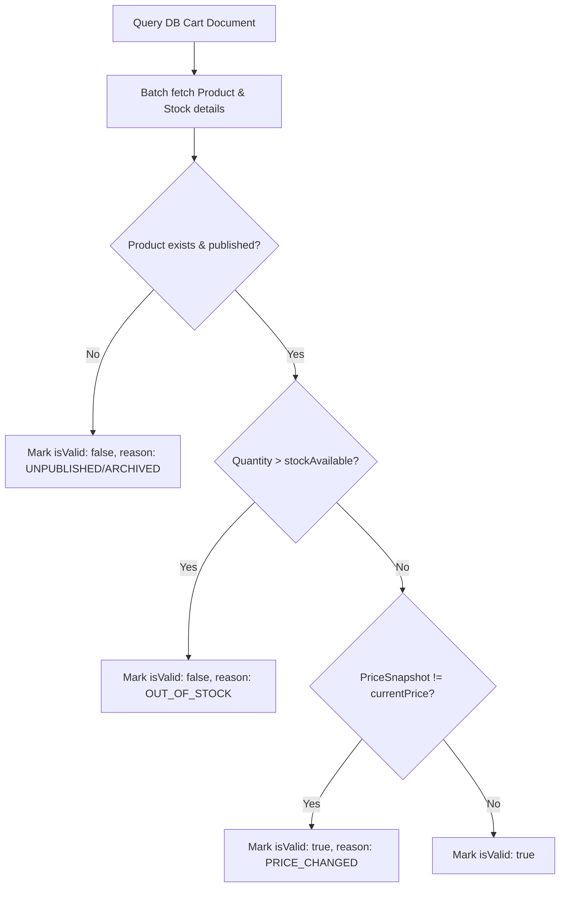

# Cart Lifecycle — Architecture & State Transitions

This document details the lifecycle stages of the shopping cart session list inside the WollyWay platform.

---

## 1. Lifecycle Diagram



---

## 2. Dynamic Status Mapping (GET non-mutating validation)

Instead of silently updating database documents during read queries, the Cart domain maps invalid states dynamically to the client:



- Invalid items (marked `isValid: false`) are **excluded** from derived totals calculations.
- Mismatched prices (marked `priceChanged: true`) are flagged to prompt user updates before initiating checkout.

---

## 3. Concurrency Protection (Version Retries)

When concurrent quantity modifications are executed on the same cart document:

```
Process A: Reads Cart (v1)  ──────► Modifies Array ──────► Saves (Success, v2)
Process B: Reads Cart (v1)  ──────► Modifies Array ──────► Version Conflict Error (Retries)
                                                                 │
                                                                 ▼
                                                        Re-reads Cart (v2)
                                                                 │
                                                                 ▼
                                                       Checks stock constraints
                                                                 │
                                                                 ▼
                                                        Saves (Success, v3)
```

- Exponential backoff delays: Attempt 1 = 50ms delay, Attempt 2 = 100ms delay, Attempt 3 = 200ms delay.
- The service throws a `409 Conflict` error to the client only if all 4 attempts fail version verification checks.
