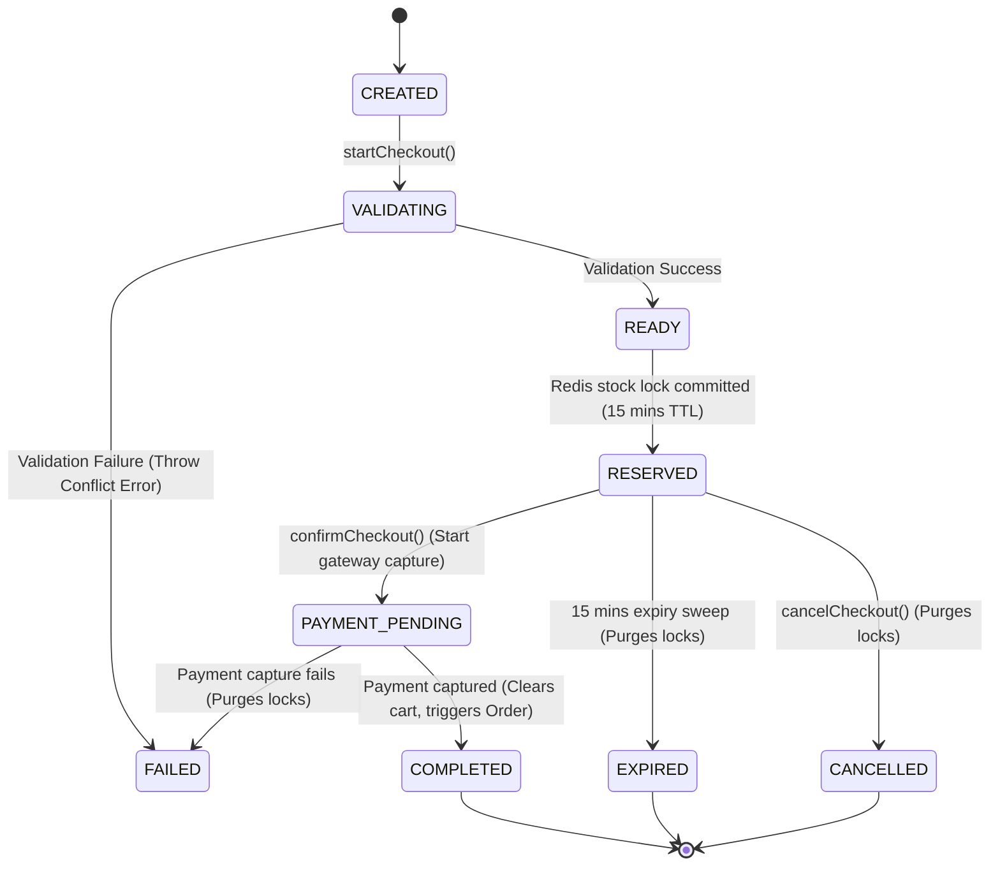

# Checkout Lifecycle — State Transitions & Validation Pipelines

This document details the lifecycle stages and validation sweeps of the WollyWay checkout coordinator.

---

## 1. Lifecycle State Machine Diagram



---

## 2. Boot Recovery & Reconciliation Sweep

In the event of a server restart or crash, keys in Redis might expire while the server listener is offline. The following recovery process is executed on startup:

```
[Server Bootstrap] ──► [Query MongoDB CheckoutSessions]
                              │
                              ├─► Filter: status = READY/PAYMENT_PENDING
                              ├─► Filter: reservationExpiresAt < Now()
                              │
                              ▼
                       [Trigger expireSession()]
                              │
                              ├─► Call Redis: Purge locks
                              └─► Call MongoDB: Update status = EXPIRED
```

This guarantees consistent, clean inventory balances across crash cycles.

---

## 3. Idempotency Key Lock Check

To prevent multiple payment intent requests (e.g. from network retries or double-clicking):

```
                       [POST /checkout/confirm]
                                  │
                                  ▼
                     [Redis Get idempotency:key]
                                  │
         ┌────────────────────────┴────────────────────────┐
         ▼                                                 ▼
   [Key Found?]                                      [Key Not Found]
         │                                                 │
   ┌─────┴──────────────┐                           ┌──────┴──────────────┐
   ▼                    ▼                           ▼                     ▼
[Pending]           [Completed]                [Setex Key 120s]      [Run Service]
   │                    │                           │                     │
Return 409          Return Cache               Run Process           Save results & return
```
- A lock is active for 2 minutes (`120s`) while payment gateway Handshakes execute.
