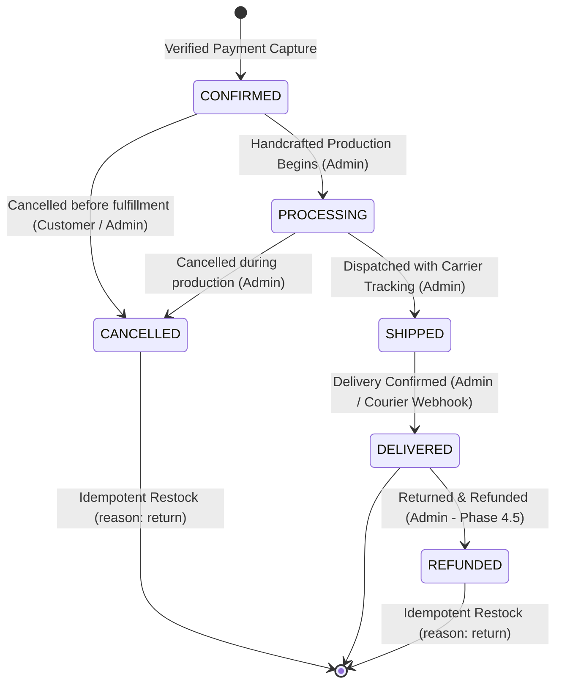

# Order Domain: Lifecycle State Machine & Invariant Architecture

This document details the fulfillment lifecycle, state machine transitions, inventory commitment invariants, and idempotency guarantees of the WollyWay Order Domain.

---

## 1. State Transition Diagram



---

## 2. Core Invariants

1. **Prepaid-Only Guarantee (Phase 4.4):** Orders are created solely upon verified prepaid capture confirmation (`stripe` or `razorpay`). Orders are never instantiated in an unpaid `PENDING` state.
2. **ACID Transaction Boundary:** Order creation, permanent inventory deduction, `InventoryTransaction` audit creation, `CheckoutSession` status transition to `COMPLETED`, and `Cart` clearing all execute atomically inside a single MongoDB Multi-Document Replica Set Transaction (`session.withTransaction`).
3. **Untracked Inventory Invariant:** For items with `trackInventory: false`, available stock is **never decremented**, while `sold` counter is incremented.
4. **Idempotency & Race Protection:** Dual unique indexes on `checkoutSessionId` and `paymentInfo.transactionId` guarantee that concurrent or repeated payment confirmation webhooks create exactly one order.
5. **Idempotent Restocking:** Cancellation and refunds restock inventory exactly once upon the state transition.
6. **Product Archival Protection:** Products with active, unsettled orders (`CONFIRMED`, `PROCESSING`, `SHIPPED`) cannot be archived.

---

## 3. Distributed Saga Handshake Sequence

```
[Payment Gateway Capture] ──► [Server-Side Webhook]
                                     │
                                     ▼
                      [MongoDB Replica Set Transaction]
                                     ├─► Create Order (Frozen Snapshots)
                                     ├─► Deduct Stock (available -= qty, sold += qty)
                                     ├─► Write InventoryTransaction ('purchase')
                                     ├─► Update CheckoutSession ('COMPLETED')
                                     └─► Empty User Cart (items = [])
                                     │
                            [Commit Successful]
                                     │
                                     ▼
                      [Post-Transaction Action]
                                     └─► Release Redis Reservation Lock (Lua Script)
```
