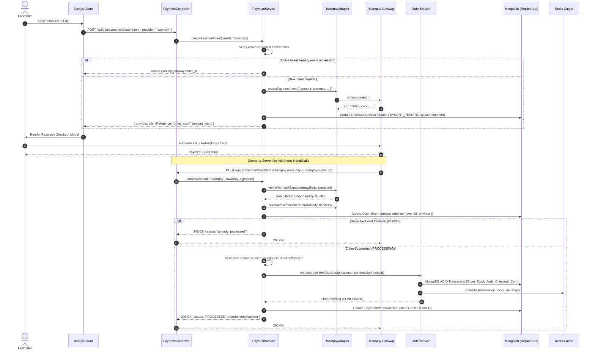

# Architecture: Payment Integration & Webhook Lifecycle

This document describes the complete flow from checkout initiation to verified webhook capture and order commitment.

---

## 1. Sequence Diagram

---

## 2. Invariants & Security Boundaries

1. **Client Untrusted:** Frontend redirects and client-provided transaction IDs are untrusted. Orders are created exclusively upon server-side webhook verification.
2. **Provider Agnosticism:** `OrderService` has no dependency on Razorpay or gateway SDKs; it accepts only `PaymentConfirmationPayload`.
3. **Atomic Claiming:** Concurrent webhook deliveries hit MongoDB's unique index on `{ eventId: 1, provider: 1 }` and are absorbed immediately.
4. **Frozen Snapshot Reconciliation:** The webhook capture amount is strictly compared to `subtotal + shippingFee + taxTotal` from the frozen `CheckoutSession` snapshot, preventing dynamic price manipulation.
5. **No Premature Processed State:** `PaymentWebhookEvent.status` transitions to `PROCESSED` **only after** `OrderService.createOrderFromCheckout()` completes successfully.
