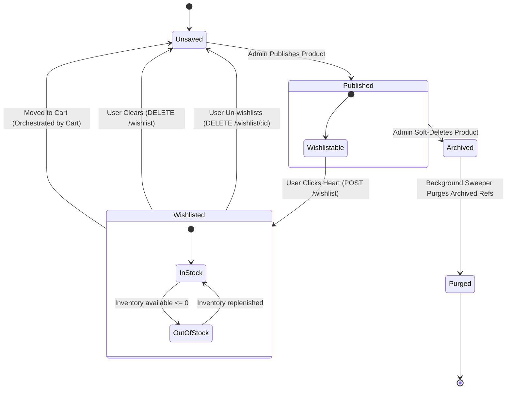

# Wishlist Lifecycle — Architecture & State Transitions

This document traces the lifecycle stages of items inside the WollyWay wishlist.

---

## 1. Lifecycle Diagram



---

## 2. Transition Rules & Validations

### A. Unsaved → Wishlisted
- Triggered by `POST /api/v1/wishlist`.
- **Pre-Conditions:**
  1. User is authenticated (JWT valid).
  2. Target product is `visibility: 'published'`.
  3. Total wishlist item count is `< 200`.
- **Database Action:** Atomic `$addToSet` append on user's array.

### B. Wishlisted → Unsaved (Remove Item)
- Triggered by `DELETE /api/v1/wishlist/:productId`.
- **Pre-Conditions:** User is authenticated.
- **Database Action:** Atomic `$pull` remove.
- **Idempotency:** Returns success if item was not wishlisted.

### C. Wishlisted → Unsaved (Clear Wishlist)
- Triggered by `DELETE /api/v1/wishlist`.
- **Pre-Conditions:** User is authenticated.
- **Database Action:** Atomic `$set` to `[]`.
- **Idempotency:** Returns empty array if already empty.

### D. Wishlisted → Move to Cart
- Triggered by Cart action.
- **Service boundary rule:** Wishlist never requests cart operations. Cart service coordinates moving an item:
  1. Call `CartService.addItem(...)`
  2. Upon success, call `WishlistService.removeFromWishlist(...)`
- This ensures transaction consistency across domains.

---

## 3. Stock State Transitions (Reactive UI)

A wishlisted item's availability details are calculated on-the-fly during response mapping:
- If `inventory.available > 0` and `inventory.isDiscontinued = false`, DTO returns:
  ```json
  "availability": { "status": "IN_STOCK", "label": "In Stock" }
  ```
- If stock is depleted, it shifts dynamically to:
  ```json
  "availability": { "status": "OUT_OF_STOCK", "label": "Out of Stock" }
  ```
- No database update occurs in the wishlist collection when stock states change. This guarantees real-time accuracy and prevents stale cached statuses.
